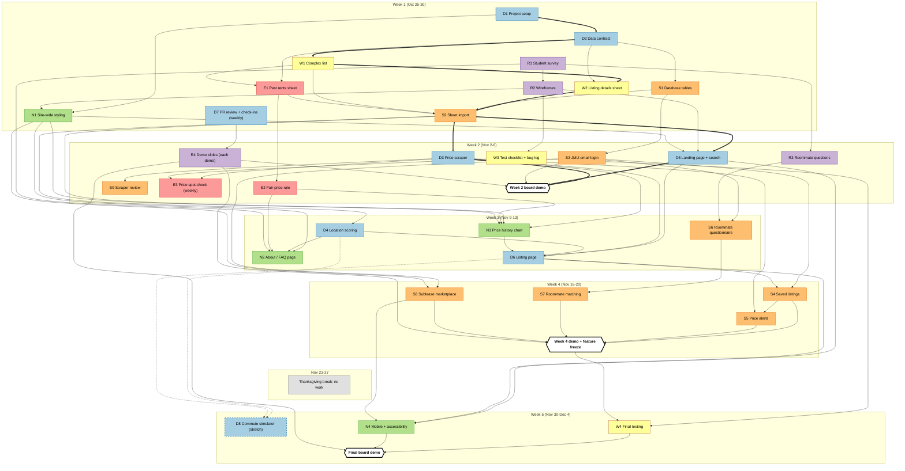

# Task Dependencies

What each person needs before starting, and when. For each person's task list
with inputs, outputs, and how to test, see [tasks.md](tasks.md).

## Big picture

```mermaid
flowchart LR
    A["Week 1 (Oct 26-30)<br/>Set up + collect data"] --> B["Week 2 (Nov 2-6)<br/>Search, login, daily prices"]
    B --> M2{{"Week 2 board demo"}}
    M2 --> C["Week 3 (Nov 9-13)<br/>Listing page, location score,<br/>price chart, roommate quiz"]
    C --> D["Week 4 (Nov 16-20)<br/>Saved listings, alerts,<br/>roommate matching, sublease"]
    D --> M4{{"Week 4 demo + feature freeze"}}
    M4 --> T["Nov 23-27<br/>Thanksgiving break"]
    T --> E["Week 5 (Nov 30-Dec 4)<br/>Test, fix, mobile pass"]
    E --> M5{{"Final board demo"}}

    classDef week fill:#e8eaf6,stroke:#3f51b5,color:#000
    classDef milestone fill:#ffffff,stroke:#000000,stroke-width:3px,color:#000,font-weight:bold
    classDef note fill:#e0e0e0,stroke:#757575,color:#000
    class A,B,C,D,E week
    class M2,M4,M5 milestone
    class T note
```

## Every task

Read top to bottom, one band per week. An arrow goes from a task to the task
that needs it. Thick arrows are the critical path: if any of those slip, the
Week 2 demo slips. The dashed task (D8) is a stretch goal. Hexagons are demos
and deadlines.

> **Note:** Nov 23-27 is Thanksgiving break. No work is planned that week.

## Legend

| Owner  | Prefix | Color |
| ------ | ------ | ----- |
| Devran | D | Light blue (`#a6cee3`) |
| Sean   | S | Orange (`#fdbf6f`) |
| Nathan | N | Green (`#b2df8a`) |
| Ethan  | E | Pink (`#fb9a99`) |
| Runa   | R | Purple (`#cab2d6`) |
| Will   | W | Yellow (`#ffff99`) |
| Demo or deadline | — | White hexagon, thick black border |

Thick arrows = critical path. Dashed border and arrows = stretch task.
Weekly tasks (D7, E3, R4) sit in the week they start.

## Tasks

| ID | Task | Owner | Week | Depends on |
| -- | ---- | ----- | ---- | ---------- |
| D1 | Project setup | Devran | 1 | — |
| D2 | Data contract (DATA.md + sheet templates) | Devran | 1 | D1 |
| D3 | Daily price scraper + Actions job | Devran | 2 | S2 |
| D4 | Location scoring | Devran | 3 | S2 |
| D5 | Landing page + search & filters | Devran | 2 | S2, R2, N1 |
| D6 | Listing page | Devran | 3 | D5, D3, D4, N3 |
| D7 | PR review, check-ins, demos | Devran | Weekly from 1 | — |
| D8 | Commute simulator (stretch) | Devran | 5 | D4, D6 |
| S1 | Database tables + access rules | Sean | 1 | D2 |
| S2 | Sheet import | Sean | 1 | S1, W1, W2, E1 |
| S3 | JMU-email login | Sean | 2 | S1 |
| S4 | Saved listings | Sean | 4 | S3, D6 |
| S5 | Price alerts | Sean | 4 | S4, D3 |
| S6 | Roommate questionnaire | Sean | 3 | S3, R3 |
| S7 | Roommate matching | Sean | 4 | S6 |
| S8 | Sublease marketplace | Sean | 4 | S3, N1 |
| S9 | Scraper review | Sean | 2 | D3 |
| N1 | Site-wide styling | Nathan | 1 | D1, R2 |
| N2 | About / FAQ page | Nathan | 3 | N1, D4, E2, R1 |
| N3 | Price history chart + fair-price badge | Nathan | 3 | D3, S2, E2, N1 |
| N4 | Mobile + accessibility pass | Nathan | 5 | D5, D6, S8 |
| E1 | Past rents sheet | Ethan | 1 | D2, W1 |
| E2 | Fair-price rule | Ethan | 2 | E1 |
| E3 | Weekly price spot-check | Ethan | Weekly from 2 | D3, W3 |
| R1 | Student survey | Runa | 1 | — |
| R2 | Wireframes | Runa | 1 | R1 |
| R3 | Roommate questions | Runa | 2 | R1 |
| R4 | Demo slides | Runa | Each demo (2, 4, 5) | D7 |
| W1 | Complex list | Will | 1 | D2 |
| W2 | Listing details sheet | Will | 1 | W1, D2 |
| W3 | Test checklist + bug log | Will | 2 | R2 |
| W4 | Final testing | Will | 5 | W3, Week 4 demo + feature freeze |
| — | **Week 2 board demo** | — | 2 | D3, D5, S3, R4 |
| — | **Week 4 demo + feature freeze** | — | 4 | S4, S5, S7, S8, R4 |
| — | **Final board demo** | — | 5 | W4, N4, R4 |
